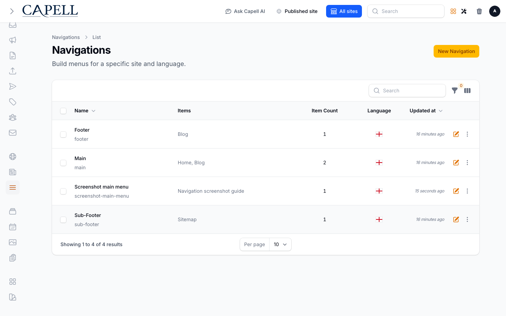
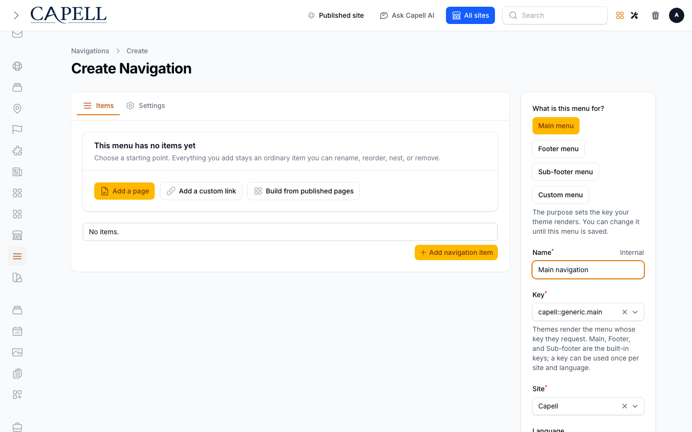

# Navigation

<!-- prettier-ignore-start -->

Editors can arrange a site's header and footer menus by dragging items into place and nesting them under a parent. Each item has a type, such as a page, a link or a heading. A parent can open as a dropdown or as a wide menu with several columns.

Every menu belongs to a site and can be set to a language, so the Welsh header can differ from the English one. If no menu exists for a language, the menu with no language set is used. Main, Footer and Sub-footer come with the setup command, which gives each site that has a home page its starting menus. You can add menus under your own names.

Every item can be shown to everyone, to guests, to signed-in visitors or to a role. Anyone who has the address can still open the page, because this hides only the link. The Foundation theme shows all three built-in menus, and a custom menu shows only where a theme or a layout widget asks for it by name.

Menus can be published at once or on a date you choose. Copying a site copies its menus and points the copies at the copied pages. When you edit a menu, a preview lists the pages and sites that can show it before you save.

- **Price and availability:** Check current availability and price on the [Capell Marketplace listing](https://capell.app/marketplace/extensions/navigation).
- **Licence:** Check the licence terms on the [Capell Marketplace listing](https://capell.app/marketplace/extensions/navigation).
- **Requires:** `PHP ^8.4`, `capell-app/admin ^1.0.79`, `capell-app/core ^1.0.79`, `capell-app/frontend ^1.0.81`.
- **Install:** `composer require capell-app/navigation`.

## Quick Start

1. Install the package: `composer require capell-app/navigation`.
2. Run the package setup: `php artisan capell:navigation-setup`.
3. See it working: run `php artisan capell:navigation-demo`.
4. Open the package admin surface at `/admin/navigation/navigations` and confirm Navigation is available.

## For Developers

The handle registry lets packages and themes contribute named menus without reaching into Navigation internals.

## Configure

- **Commands:** `php artisan capell:navigation-demo`, `php artisan capell:navigation-setup`, `php artisan capell:navigation:screenshot-fixture`.

## Limits And Pitfalls

- Install the required Capell packages at the versions in `composer.json`: `capell-app/admin ^1.0.79`, `capell-app/core ^1.0.79`, `capell-app/frontend ^1.0.81`.
- Run migrations before opening package resources or public routes.
- Keep public Blade and cached HTML free of authoring markers, model IDs, permissions, signed editor URLs, and lazy database queries.
- Custom write integrations must preserve invalidation for `navigation` cache tags.

## Screens And Workflow

- Navigation admin index (admin).
- Create/edit navigation form on desktop (admin).
- Create/edit navigation form on tablet (admin).
- Create/edit navigation form on mobile (admin).
- Site relation manager for navigations (admin).
- Page form navigation tab (admin).
- Landing page configuration tabs (admin).
- Frontend menu output (frontend).
- Navigation admin index with admin sidebar menu open (admin).

## Install Impact

- Required packages: `capell-app/admin`, `capell-app/core`, `capell-app/frontend`.
- Admin navigation: declares `admin-resource: NavigationAdminResourceContribution`; each Filament page or resource controls its own navigation visibility.
- Admin/editor extensions: `configurator: NavigationConfiguratorContribution`, `configurator: NavigationContentGraphContribution`, `configurator: NavigationFrontendRuntimeContribution`, `schema-extender: NavigationSchemaExtendersContribution`.
- Permissions: `ViewAny:Navigation`, `View:Navigation`, `Create:Navigation`, `Update:Navigation`, `Delete:Navigation`, `DeleteAny:Navigation`, `Restore:Navigation`, `RestoreAny:Navigation`, `ForceDelete:Navigation`, `ForceDeleteAny:Navigation`, `Reorder:Navigation`; access also governed by package policies: `NavigationPolicy`.
- Public routes: none declared.
- Database changes: package migrations are declared.
- Config: no package config files.
- Settings: no package settings declared.
- Queues or schedules: none declared.
- Cache tags: `navigation`.
- Commands: `capell:navigation-demo`, `capell:navigation-setup`, `capell:navigation:screenshot-fixture`.

## Troubleshooting

| Symptom | Likely cause | Check | Fix |
| --- | --- | --- | --- |
| Package surface is missing after install | Provider or manifest is not loaded | Confirm `capell.json`, package `composer.json`, and provider registration | Reinstall the package, refresh Composer autoload, and clear host caches |
| Admin screen or command fails on missing table | Package migrations have not run | Check the tables listed in `Data Model` | Run host migrations and rerun the focused package test |
| Public output leaks unexpected state | Render data, cache variation, or authoring boundary has regressed | Check public Blade, cache tags, and public-output safety tests | Move data loading out of Blade and rerun the package public-output tests |

## Upgrading

No manual steps between minor versions.

Read [CHANGELOG.md](CHANGELOG.md) before upgrading.

## Next Steps

- [Package docs](docs/README.md)
- [Overview](docs/overview.md)
- [Worked extension examples](docs/extension-contracts.md)
- [Admin guide](docs/admin-guide.md)
- [Troubleshooting](#troubleshooting)
- [Developer reference](docs/reference.md)
- [Marketplace assets](docs/assets/marketplace/)
- [Capell content language plan](../../docs/CONTENT_LANGUAGE_PLAN.md)
- [Capell documentation design system](../../docs/DESIGN_SYSTEM.md)
- [Capell and package ERD notes](../../docs/erd/capell-and-package-erds.md)
- Related packages: [Foundation Theme](../theme-foundation/README.md).

<!-- prettier-ignore-end -->
