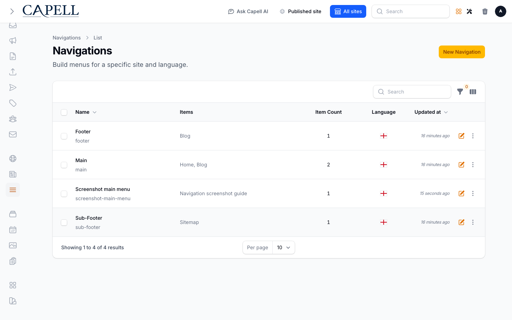
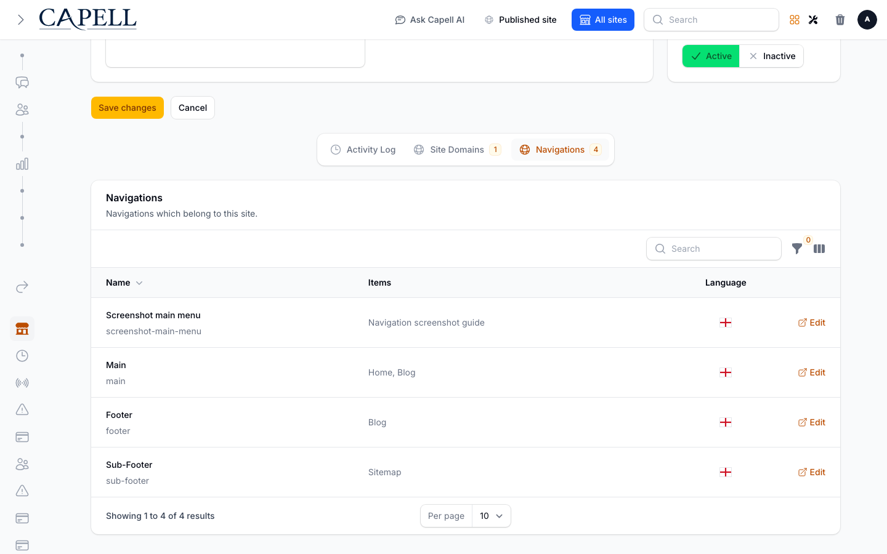
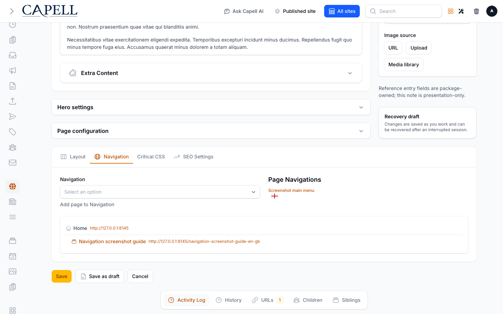

# Using Navigation

This guide is for editors who build site menus and owners deciding how menus are structured. Every step uses the labels you see on screen.

## Using Navigation (editor how-to)

### How to build a menu

1. Go to **Menus**.
2. Create a new menu. Under **What is this menu for?**, choose **Main menu**, **Footer menu**, **Sub-footer menu** or **Custom menu**. The first three connect the menu to the matching place in your theme. Choose **Custom menu** only when your developer gave you a key.
3. Choose the site and, when needed, the language for this menu. A menu of each kind can be used once for the same site and language.
4. Start with **Build from published pages** to add your top-level pages, or add items one at a time with **Add a page** or **Add a custom link**. Use **Add a custom link** for another site.
5. Save the menu.

### How to reorder and nest links

1. Open the menu in the editor.
2. Drag a link by its handle, or use its **Move up** and **Move down** buttons.
3. To nest a link under the one above it, drag it across or choose **Indent**. **Dedent** moves it back.
4. Save the menu.

### How to make a dropdown or mega menu

1. Nest links under a parent item.
2. On the parent item, choose how its children open: **Standard dropdown** or **Mega menu**.
3. Save the menu.

### How to make a menu appear in a theme location

1. Create a menu and choose **Main menu**, **Footer menu** or **Sub-footer menu** under **What is this menu for?**. The theme renders the menu that matches its place.
2. For any other place your theme offers, choose **Custom menu** and enter the key your developer gave you.
3. Choose the site and language, then save.
4. Preview the public page. The theme decides where that key appears; there is no separate Header or Footer assignment control.

### How to manage menus from a site

1. Open the site you are working on.
2. Use the **Menus** area on the site to add or edit the menus that belong to it.
3. Save. This keeps each site's menus together in one place.

### How to see which menus contain a page

1. Open the page you want to control.
2. Go to its navigation tab.
3. Review the menus that already contain the page. The list is read-only; to add or remove the page, edit the menu under **Menus**.

## Rolling out Navigation (for owners)

### Turn on first

- A header menu with your main pages. Get the primary navigation right before adding footer menus or dropdowns.

### Add when needed

| Need                                   | Enable                                 |
| -------------------------------------- | -------------------------------------- |
| Group related pages under one heading  | Nested links (a **Standard dropdown**) |
| A large menu with sections and columns | A **Mega menu**                        |
| Links at the bottom of every page      | A **Footer menu**                      |

### Don't enable yet

- Avoid mega menus until you have enough pages to fill them. A simple dropdown is clearer for small sites.

### Who does what

| Role       | First useful screen                                            |
| ---------- | -------------------------------------------------------------- |
| Editor     | The menu editor: add, nest, and reorder links                  |
| Site owner | **Menus**: review each menu's site, language, and rendered key |

## Troubleshooting for editors

| What you see                         | What it means                                                                                   | What to do                                                                                                    |
| ------------------------------------ | ----------------------------------------------------------------------------------------------- | ------------------------------------------------------------------------------------------------------------- |
| A new menu isn't showing on the site | Its key is not one the theme renders, or the menu is not eligible for the current site/language | Match the menu **Key** to the theme's rendered key, check the site and language, then preview the public page |
| A link goes to the wrong place       | The page reference or external URL is wrong                                                     | Open the link and fix its target                                                                              |
| A dropdown isn't opening             | Its child links aren't nested, or the layout isn't set                                          | Nest the links under the parent and set **Standard dropdown** or **Mega menu**                                |
| A menu item points to a deleted page | The page it linked to no longer exists                                                          | Remove or repoint the link, then save                                                                         |
